# Лабораторная работа № 2. Методы принятия решений при многих критериях

Дисциплина «Базы знаний и принятие проектных решений в САПР», **вариант 3**.
Лабораторная работа № 2 соответствует лабораторной работе № 6 методического пособия `pract.pdf`.

Программа выбирает площадку для строительства предприятия: отсеивает заведомо худшие варианты
по Парето, вычисляет веса критериев методом ранга и находит лучшую площадку методом ЭЛЕКТРА.
Пороговые значения меняются ползунками, поэтому в ответе можно оставить одну или две площадки.
Расчёт дублируется книгой Excel с живыми формулами.

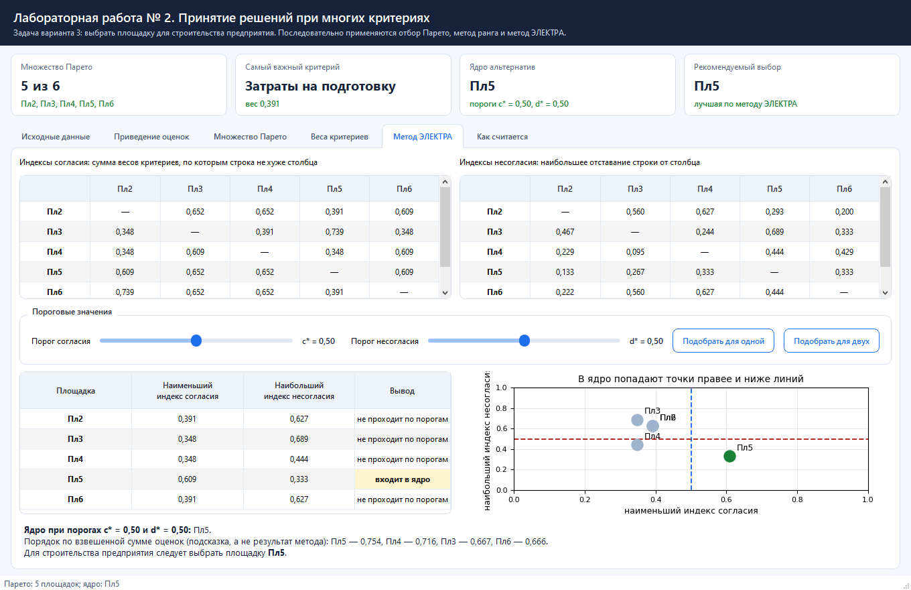

---

## Содержание

1. [Условие задачи](#условие-задачи)
2. [Быстрый старт](#быстрый-старт)
3. [Порядок решения](#порядок-решения)
4. [Шаг 1. Приведение оценок](#шаг-1-приведение-оценок)
5. [Шаг 2. Множество Парето](#шаг-2-множество-парето)
6. [Шаг 3. Веса критериев (метод ранга)](#шаг-3-веса-критериев-метод-ранга)
7. [Шаг 4. Метод ЭЛЕКТРА](#шаг-4-метод-электра)
8. [Как пользоваться программой](#как-пользоваться-программой)
9. [Проверка в Excel](#проверка-в-excel)
10. [Структура проекта](#структура-проекта)
11. [Тесты](#тесты)
12. [Ответ на вопрос задачи](#ответ-на-вопрос-задачи)

---

## Условие задачи

Предлагаются шесть вариантов площадки для строительства нового предприятия.
Характеристики площадок:

| Площадка | Пл1 | Пл2 | Пл3 | Пл4 | Пл5 | Пл6 |
|---|---|---|---|---|---|---|
| Дорожная сеть | средняя | плохая | развитая | развитая (немного лучше, чем у Пл3) | средняя | плохая |
| Энергоснабжение | хорошее | хорошее | плохое | среднее | очень хорошее | среднее |
| Затраты на подготовку к строительству, млн ден. ед. | 3,5 | 2,5 | 3 | 3,5 | 3 | 2,0 |

Важность критериев оценивают два эксперта:

* **Эксперт 1**: наиболее важный критерий — затраты на подготовку к строительству,
  менее важны и одинаково важны между собой дорожная сеть и энергоснабжение.
* **Эксперт 2**: наиболее важный критерий — дорожная сеть, немного менее важный — затраты
  на подготовку, ещё немного менее важный — энергоснабжение.

Требуется выбрать множество Парето, вычислить веса критериев методом ранга и выполнить
анализ отобранных альтернатив методом ЭЛЕКТРА, предусмотрев выбор одной или двух площадок
за счёт изменения пороговых значений.

---

## Быстрый старт

Нужен Python версии 3.10 или новее. Проверить версию:

```bash
python --version
```

### Windows (PowerShell или командная строка)

```bat
git clone https://github.com/dezshev/BZiPPRvSAPR-labs.git
cd BZiPPRvSAPR-labs
git checkout lab2

python -m venv .venv
.venv\Scripts\activate

pip install -r requirements.txt
python main.py
```

### Linux или macOS

```bash
git clone https://github.com/dezshev/BZiPPRvSAPR-labs.git
cd BZiPPRvSAPR-labs
git checkout lab2

python3 -m venv .venv
source .venv/bin/activate

pip install -r requirements.txt
python main.py
```

Окно открывается сразу с данными варианта 3 и готовым расчётом.

> Если репозиторий скачан архивом (кнопка «Code» → «Download ZIP»), шаги с `git` не нужны:
> распакуйте архив, откройте папку в терминале и начните с команды `python -m venv .venv`.

| Пакет | Зачем |
|---|---|
| `PySide6` | окно программы, таблицы, ползунки |
| `matplotlib` | диаграммы площадок, весов и порогов |
| `openpyxl` | запись книги Excel с формулами |

---

## Порядок решения

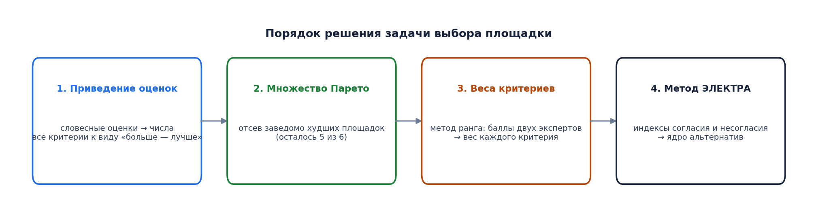

---

## Шаг 1. Приведение оценок

Критерии измеряются по-разному: два словами, один в миллионах денежных единиц.
Чтобы их можно было сравнивать, оценки приводятся к единому виду.

Сначала словесные оценки переводятся в числа по шкале Харрингтона:

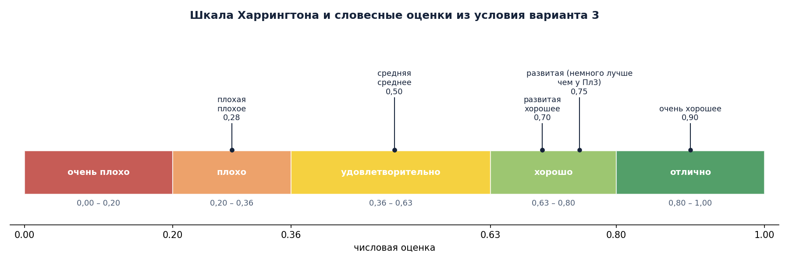

Дорожная сеть площадки Пл4 по условию «немного лучше, чем у Пл3», поэтому обе оценки
попадают в диапазон «хорошо», но Пл3 получает 0,70, а Пл4 — 0,75.

Затем все критерии приводятся к безразмерному виду так, чтобы лучшая оценка равнялась единице:

* дорожная сеть и энергоснабжение — «больше значит лучше», поэтому оценки делятся на наибольшую;
* затраты — «меньше значит лучше», поэтому берётся отношение наименьших затрат к затратам площадки.

| Критерий | Пл1 | Пл2 | Пл3 | Пл4 | Пл5 | Пл6 |
|---|---:|---:|---:|---:|---:|---:|
| Дорожная сеть | 0,667 | 0,373 | 0,933 | **1,000** | 0,667 | 0,373 |
| Энергоснабжение | 0,778 | 0,778 | 0,311 | 0,556 | **1,000** | 0,556 |
| Затраты на подготовку | 0,571 | 0,800 | 0,667 | 0,571 | 0,667 | **1,000** |

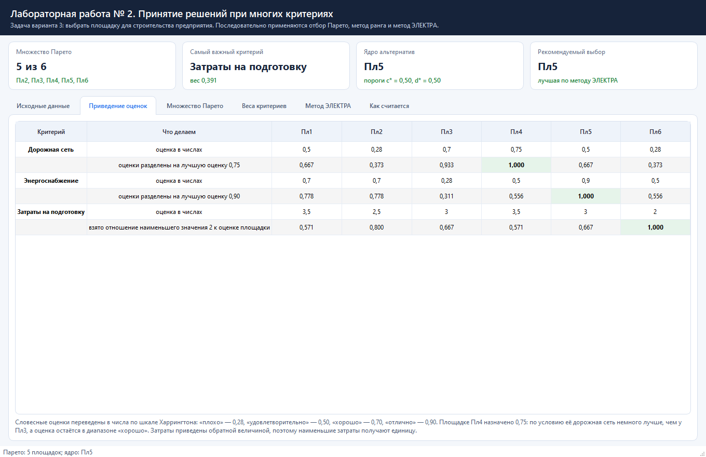

---

## Шаг 2. Множество Парето

Площадка исключается, если найдётся другая, которая не хуже неё по всем критериям
и лучше хотя бы по одному: такую площадку никто не выберет.

Единственная пара, где это выполняется, — Пл1 и Пл5. У них одинаковая дорожная сеть (0,667),
но у Пл5 лучше энергоснабжение (1,000 против 0,778) и выгоднее затраты (0,667 против 0,571).
Поэтому **Пл1 исключается**, а остальные пять площадок образуют множество Парето.

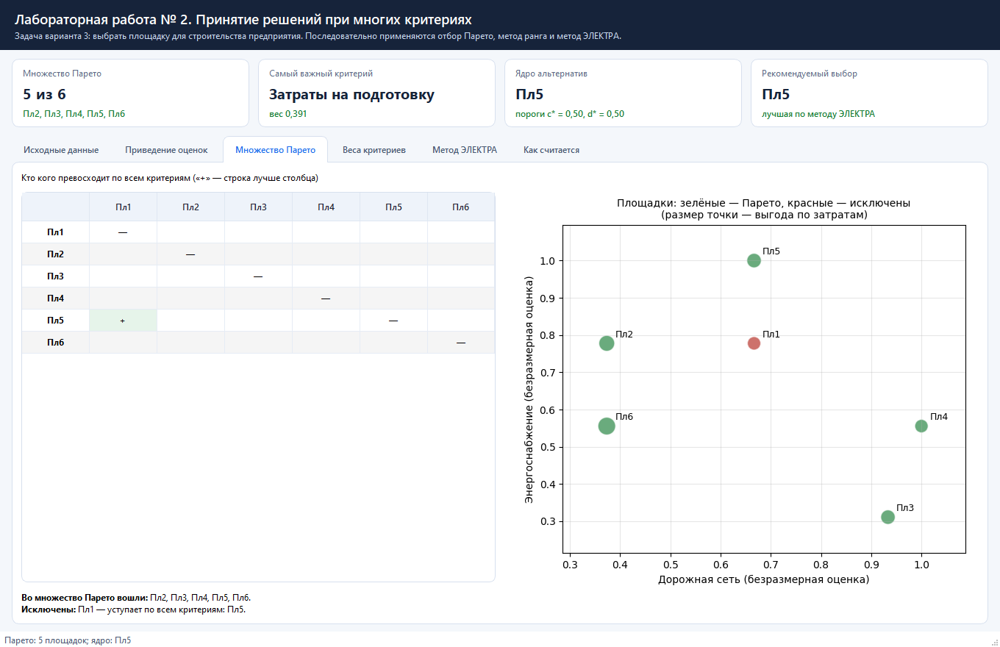

Наглядное сравнение всех шести площадок:

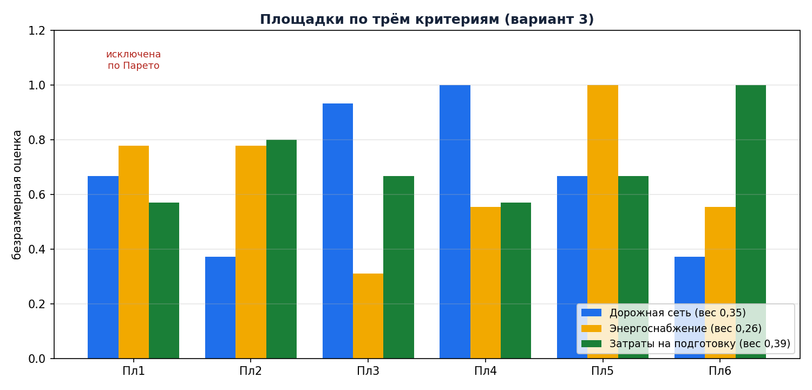

---

## Шаг 3. Веса критериев (метод ранга)

Каждый эксперт выставляет критериям баллы по пятибалльной шкале: чем важнее критерий,
тем выше балл. Мнения экспертов из условия переведены в баллы так:

| Критерий | Эксперт 1 | Эксперт 2 | Сумма баллов | Вес критерия |
|---|---:|---:|---:|---:|
| Дорожная сеть | 3 | 5 | 8 | 0,348 |
| Энергоснабжение | 3 | 3 | 6 | 0,261 |
| Затраты на подготовку | 5 | 4 | 9 | **0,391** |
| **Итого** | | | **23** | **1,000** |

Вес критерия — доля его баллов в общей сумме: например, 8 / 23 = 0,348.
Баллы в программе можно менять, веса пересчитаются сразу.

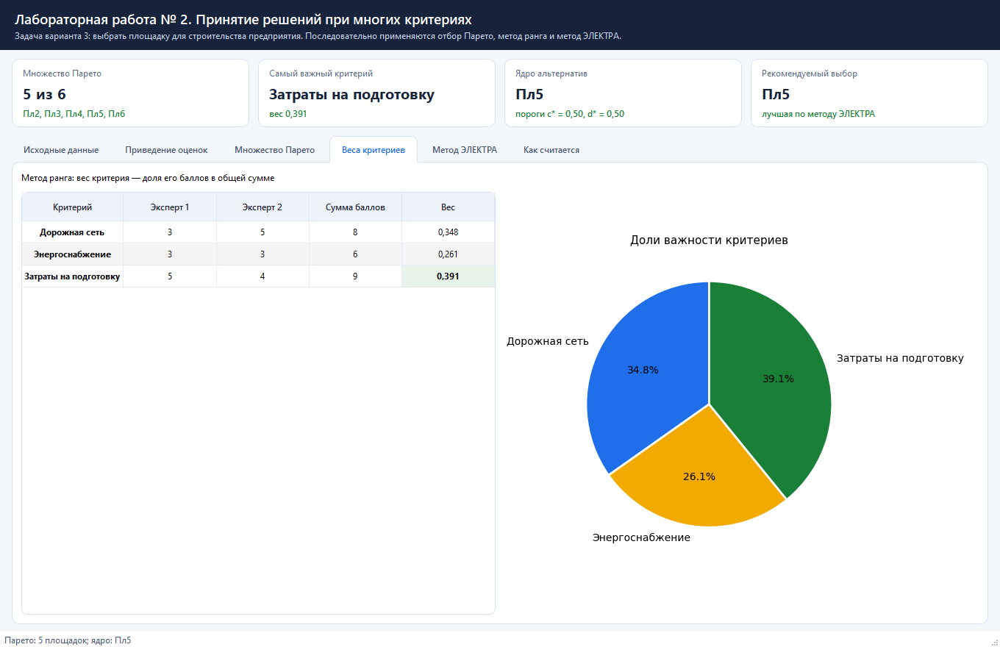

---

## Шаг 4. Метод ЭЛЕКТРА

Для каждой пары площадок выдвигается предположение «первая лучше второй» и считаются два числа.

**Индекс согласия** — сумма весов критериев, по которым первая площадка не хуже второй.
Чем он больше, тем сильнее подтверждается предположение.

| |Пл2|Пл3|Пл4|Пл5|Пл6|
|---|---:|---:|---:|---:|---:|
| **Пл2** |—|0,652|0,652|0,391|0,609|
| **Пл3** |0,348|—|0,391|0,739|0,348|
| **Пл4** |0,348|0,609|—|0,348|0,609|
| **Пл5** |0,609|0,652|0,652|—|0,609|
| **Пл6** |0,739|0,652|0,652|0,391|—|

**Индекс несогласия** — наибольшее отставание первой площадки от второй среди остальных
критериев. Чем он больше, тем сильнее возражение против предположения.

| |Пл2|Пл3|Пл4|Пл5|Пл6|
|---|---:|---:|---:|---:|---:|
| **Пл2** |—|0,560|0,627|0,293|0,200|
| **Пл3** |0,467|—|0,244|0,689|0,333|
| **Пл4** |0,229|0,095|—|0,444|0,429|
| **Пл5** |0,133|0,267|0,333|—|0,333|
| **Пл6** |0,222|0,560|0,627|0,444|—|

Затем для каждой площадки берутся наименьший индекс согласия и наибольший индекс несогласия.
В «ядро» попадают площадки, у которых наименьший индекс согласия не ниже порога **c\***,
а наибольший индекс несогласия не выше порога **d\***. Обычно берут c\* = d\* = 0,5.

| Площадка | Наименьший индекс согласия | Наибольший индекс несогласия | Вывод при c\* = d\* = 0,5 |
|---|---:|---:|---|
| Пл2 | 0,391 | 0,627 | не проходит |
| Пл3 | 0,348 | 0,689 | не проходит |
| Пл4 | 0,348 | 0,444 | не проходит |
| **Пл5** | **0,609** | **0,333** | **входит в ядро** |
| Пл6 | 0,391 | 0,627 | не проходит |

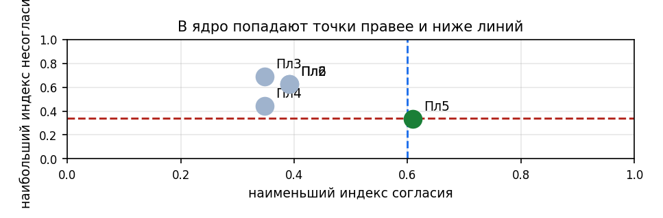

### Выбор двух площадок

По условию работы нужно уметь оставлять одну или две площадки. Для этого достаточно ослабить
пороги: при **c\* = 0,34 и d\* = 0,45** в ядро попадают **Пл4 и Пл5**. В программе это делает
кнопка «Подобрать для двух».

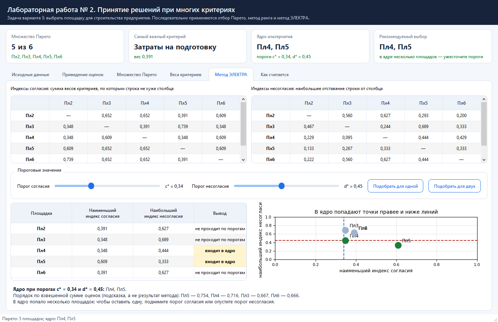

---

## Как пользоваться программой

1. **Вкладка «Исходные данные».** Словесные оценки выбираются из списка, затраты вводятся числом,
   баллы экспертов — стрелками. Любое изменение сразу пересчитывает весь расчёт.
   Кнопка «Вернуть данные варианта 3» возвращает исходное условие.
2. **Вкладка «Приведение оценок».** Видно, какое число получила каждая словесная оценка
   и как она превратилась в безразмерную.
3. **Вкладка «Множество Парето».** Таблица показывает, кто кого превосходит по всем критериям,
   рядом — диаграмма площадок: зелёные попали во множество Парето, красные исключены.
4. **Вкладка «Веса критериев».** Баллы экспертов, суммы и веса, рядом — круговая диаграмма.
5. **Вкладка «Метод ЭЛЕКТРА».** Обе матрицы, ползунки порогов, таблица ядра и диаграмма:
   в ядро попадают точки правее вертикальной и ниже горизонтальной линии.
6. **Вкладка «Как считается».** Краткое описание метода прямо в программе.

Карточки сверху всегда показывают главное: сколько площадок осталось после Парето,
самый важный критерий, состав ядра и рекомендуемый выбор.

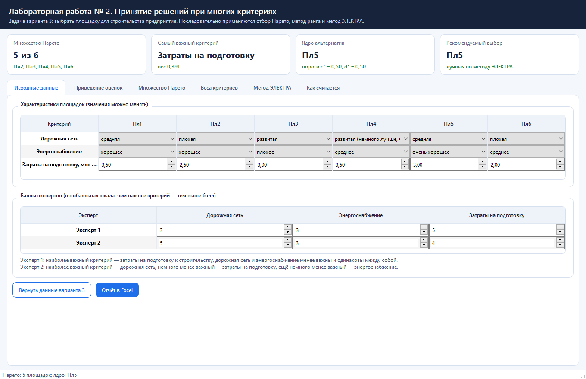

---

## Проверка в Excel

Кнопка «Отчёт в Excel» сохраняет книгу из шести листов:

| Лист | Что содержит |
|---|---|
| **Исходные данные** | условие задачи, шкала Харрингтона и баллы экспертов |
| **Приведение** | перевод словесных оценок формулой `ВПР` и нормирование формулами |
| **Веса** | суммы баллов и веса критериев формулами |
| **Парето** | матрица превосходства и отбор площадок формулами |
| **ЭЛЕКТРА** | матрицы согласия и несогласия формулами `СУММПРОИЗВ` |
| **Свод** | сравнение чисел программы и Excel, пороги и ядро |

На листе «Свод» столбцы программы и Excel стоят рядом, а внизу выводится итог проверки.
Пороги c\* и d\* лежат в отдельных ячейках: если их поменять, столбец «Вывод Excel»
пересчитается сам.

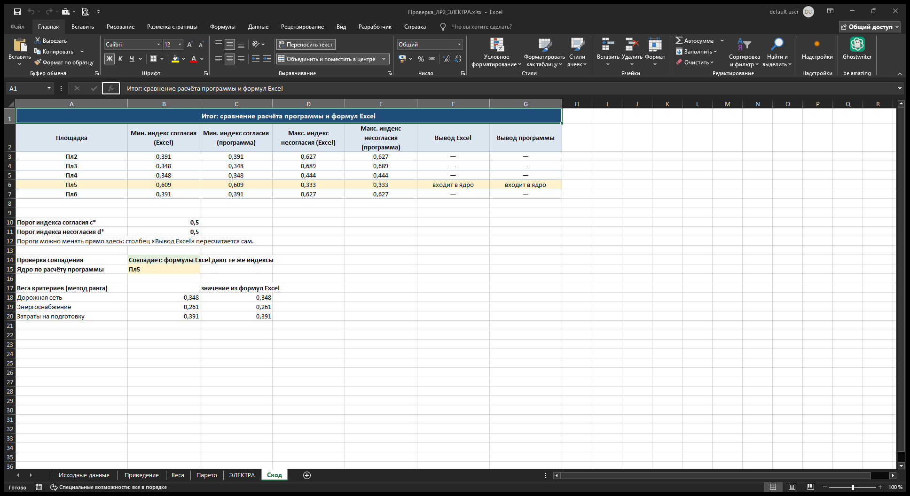

Индексы согласия и несогласия Excel считает своими формулами:

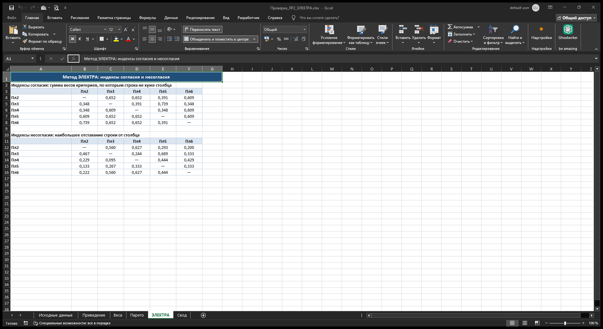

Множество Парето Excel тоже отбирает сам и сравнивает результат с программой:

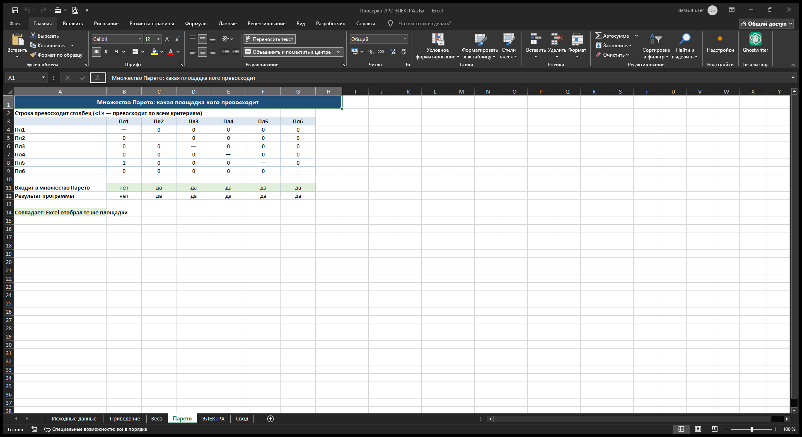

Пример готового отчёта лежит в репозитории:
[`docs/example/Проверка_ЛР2_ЭЛЕКТРА.xlsx`](docs/example).
Проверка в нём даёт «Совпадает: формулы Excel дают те же индексы», а множество Парето,
веса и ядро совпадают с расчётом программы.

---

## Структура проекта

```
BZiPPRvSAPR-labs (ветка lab2)
├── main.py                      запуск приложения
├── requirements.txt             список зависимостей
├── electre/
│   ├── data.py                  условие варианта 3 и шкала Харрингтона
│   ├── methods.py               приведение оценок, Парето, метод ранга, ЭЛЕКТРА
│   ├── excel_report.py          книга Excel с формулами для проверки
│   └── ui.py                    окно программы
├── tools/
│   ├── make_docs_images.py      рисунки для этого файла
│   ├── make_screenshots.py      снимки окна программы
│   └── make_excel_screenshot.py пример отчёта и снимки Excel
├── tests/
│   └── test_lab2.py             проверки всех шагов расчёта
└── docs/
    ├── img/                     картинки для README
    └── example/                 пример готового отчёта Excel
```

Расчёт отделён от интерфейса, поэтому методами можно пользоваться отдельно:

```python
from electre.data import variant_3
from electre.methods import electre, normalize, pareto, rank_weights

task = variant_3()
normalized = normalize(task)
selected = pareto(normalized)
weights = rank_weights(task.expert_scores)
result = electre(normalized, weights.values, selected.kept, 0.5, 0.5)
print(result.core_names())      # ['Пл5']
```

---

## Тесты

```bash
python -m unittest discover -s tests -v
```

Что проверяется:

* словесные оценки переводятся по шкале Харрингтона, лучшая оценка по каждому критерию равна единице;
* для затрат меньшее значение даёт большую безразмерную оценку;
* площадка Пл1 исключается по Парето, остальные пять остаются, и ни одна из них не уступает другой;
* веса критериев в сумме дают единицу и совпадают с ручным расчётом 8/23, 6/23 и 9/23;
* индексы согласия и несогласия совпадают с ручным подсчётом для каждой пары площадок;
* при порогах 0,5 и 0,5 ядро состоит из одной площадки Пл5;
* ослабление порогов расширяет ядро, ужесточение делает его пустым;
* подбор порогов даёт ядро нужного размера (одна, две или три площадки).

---

## Ответ на вопрос задачи

**Множество Парето:** Пл2, Пл3, Пл4, Пл5, Пл6 (площадка Пл1 исключена, её во всём превосходит Пл5).

**Веса критериев:** затраты на подготовку — 0,391, дорожная сеть — 0,348, энергоснабжение — 0,261.

**Результат метода ЭЛЕКТРА:** при обычных порогах c\* = d\* = 0,5 ядро состоит из одной площадки —
**Пл5**. У неё самый высокий наименьший индекс согласия (0,609) и самый низкий наибольший индекс
несогласия (0,333): ни одна другая площадка не превосходит её заметно ни по одному критерию.

Если требуется оставить две площадки, пороги ослабляются до c\* = 0,34 и d\* = 0,45 —
тогда к Пл5 добавляется **Пл4** (лучшая дорожная сеть, но заметно дороже подготовка).

**Вывод: предприятие следует строить на площадке Пл5** — очень хорошее энергоснабжение,
средняя дорожная сеть и умеренные затраты на подготовку.

---
